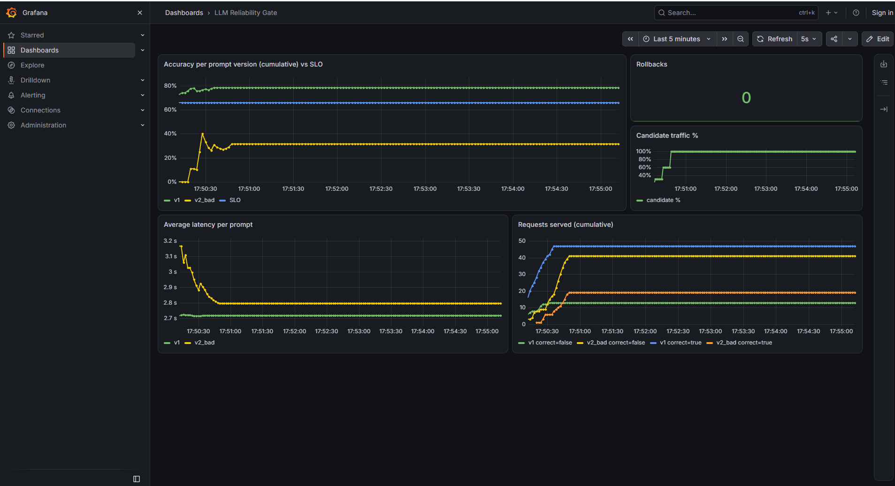
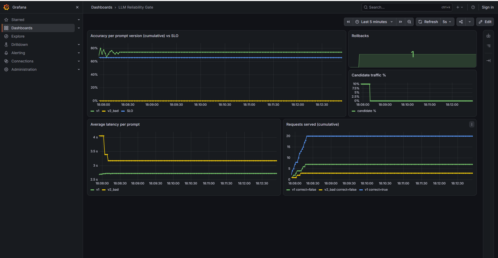

# LLM Reliability Gate

**Ship prompt changes the way SRE ships code: measured, gradual, and automatically reversible.**

A small release gate for LLM-powered features. It measures answer quality as an SLI, rolls a new prompt out in canary steps (10% → 30% → 60% → 100%), and rolls back automatically when quality drops below the SLO. Everything runs locally and for free: Python + [Ollama](https://ollama.com), with optional OpenTelemetry → Grafana (Tempo, Loki, Prometheus).

## Why

An LLM feature can return HTTP 200 and still be wrong. Prompt edits are changes to production behaviour, yet they usually ship to 100% of users with no test and no easy rollback. This project applies standard SRE practice (SLI/SLO, error budget thinking, canary, rollback) to that problem.

## How it works

```
 prompt v2 ──► canary 10% ─► 30% ─► 60% ─► 100% ──► holdout check ──► promoted
                 │            │       │
                 └─ accuracy below SLO, or 0 correct answers ──► automatic rollback to v1
```

1. `baseline` measures the current prompt (v1) on 50 labelled messages and sets the **SLO = baseline accuracy − 10 points**.
2. `canary` sends a growing share of traffic to the candidate prompt and judges its accuracy against the SLO (needs ≥ 5 answers, or an immediate rollback if 0 of 3 are correct).
3. Before promotion, the candidate must not be more than 10 points worse than v1 on a **holdout set** never used for tuning.

Use case: classifying Persian customer-support tickets into `billing`, `delivery`, `tech`.

## Results (one run, `llama3.2:3b` on CPU)

| Scenario | Outcome | Accuracy users saw |
|---|---|---|
| Baseline (v1) | 76% accuracy, SLO = 66% | |
| Bad prompt, gate **off** | rolled out to 100% | fell to **33%** |
| Bad prompt, gate **on** | rolled back at the 10% step (0 of 3 correct) | 67% during the step, then back on v1 |
| Good prompt | reached 100%, holdout 88% vs 83% | 87% |

Model output varies slightly between runs, and the samples are small (see Limitations).

## Quick start

Requirements: Python 3.10+, Ollama with a model pulled (`ollama pull llama3.2:3b`).

```bash
pip install -r requirements.txt
python reliability.py baseline
python reliability.py canary v2_good
python reliability.py canary v2_bad
python reliability.py canary v2_bad --no-guard
```

Open `report.html` after each run. Answers are cached in `cache.json`, so reruns are instant. Delete it for a fresh run. Use another model with `MODEL=llama3.2:1b`.

## Observability (optional)

```bash
docker compose up -d
pip install -r requirements-otel.txt
python reliability.py canary v2_bad --otel --pace 0.4
```

Grafana runs at http://localhost:3000 (`admin` / `admin`, local use only). Import `dashboards/llm-gate.json` via *Dashboards → New → Import* (the compose file also mounts it for auto-provisioning; if it does not appear, import manually).

| Panel | Shows |
|---|---|
| Accuracy per prompt version vs SLO | cumulative accuracy of each prompt, with the SLO line |
| Rollbacks | number of automatic rollbacks |
| Candidate traffic % | share of traffic on the new prompt |
| Average latency | mean latency per prompt version |
| Requests served | correct / incorrect answers per prompt |

**Without the gate:** the bad prompt reaches 100% of traffic; its accuracy (yellow, ~32%) stays far below the SLO (blue, 66%).



**With the gate:** rollback fires at the 10% step (Rollbacks = 1) and candidate traffic returns to 0%.



Traces (Tempo) carry prompt version, expected vs actual label, and latency. Logs (Loki) record wrong answers and every gate decision.

## Project layout

| Path | Purpose |
|---|---|
| `reliability.py` | baseline, canary, rollback, holdout gate, OpenTelemetry |
| `messages.json` | 50 labelled messages (dev set, used for traffic) |
| `holdout.json` | 24 labelled messages never used for tuning |
| `prompts/` | `v1` (current), `v2_good`, `v2_bad` (deliberately broken) |
| `docker-compose.yml` | Grafana LGTM stack (`grafana/otel-lgtm`) |
| `dashboards/llm-gate.json` | Grafana dashboard |
| `cache.json`, `baseline.json`, `report.html` | generated at runtime (git-ignored) |

## Limitations

- Small local model; baseline accuracy is only 76%.
- The first canary step judges on 3 answers, enough for a badly broken prompt, not for subtle regressions.
- The holdout set has 24 messages; 88% vs 83% is a one-message difference.
- Results are from a single run; no statistical test.
- Traffic is replayed from a labelled set, not live.

## Roadmap

- Fallback to a cheaper model on latency spikes
- Token cost budget (error-budget style)
- Non-zero exit code on rollback, for use as a CI gate
- Staged-autonomy on-call assistant (L1 → L3)

## Background

Concepts follow the SRE chapters on supporting AI systems: quality as an SLO, prompts and configs as a change surface, canary analysis, reversible actions.

## License

MIT
